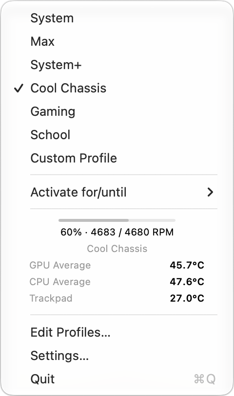
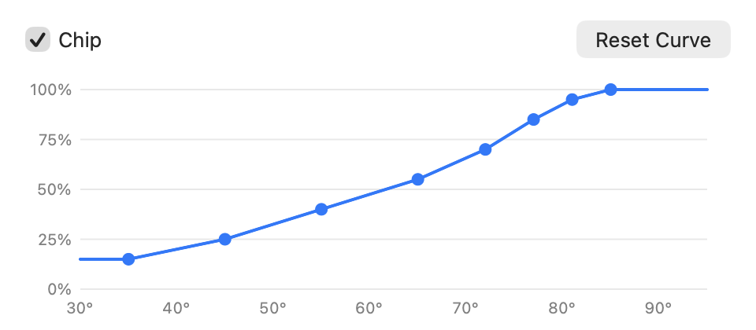

<p align="center">
  
</p>

<h1 align="center">Fandy</h1>
<p align="center">Native Mac fan control with powerful profiles, automation, custom curves, and live temperatures.</p>
<p align="center">
  <a href="https://github.com/NidaleNieve/Fandy_MacOS/releases/latest/download/Fandy-0.4.0-arm64.dmg"><strong>Download for Mac</strong></a>
  · <a href="docs/INSTALLATION.md">Installation help</a>
  · <a href="https://github.com/NidaleNieve/Fandy_MacOS/issues">Report an issue</a>
</p>
<p align="center">Apple Silicon MacBook Pro · macOS 15 or later · Signed &amp; notarized</p>

<p align="center">
  
  &nbsp;
  
</p>

Fandy is a native macOS fan controller and temperature monitor built for Apple Silicon MacBook Pros. Create custom cooling profiles, shape fan curves around chip or chassis temperatures, and automate when profiles activate.

Profiles can follow schedules, react to apps, run temporarily, or stay active for exactly as long as you need. Everything is designed to stay simple to use while giving you much deeper control than a basic fan utility.

Vibecoded with Codex, but very polished.

## Get started

1. Download the **DMG**, open it, and drag **Fandy** into **Applications**.
2. Open Fandy. Its setup window guides you to enable **Background App Activity** in System Settings.
3. Click the fan icon in the menu bar and choose a profile.

## Cooling profiles

| Profile | Best for |
| :--- | :--- |
| **System** | Lets macOS manage the fans. |
| **System+** | Gentle, earlier airflow for everyday use. |
| **Cool Chassis** | Keeps the typing area cool and comfortable. |
| **Gaming** | Very early and stronger cooling during sustained loads. |
| **Silent** | Keeps the fans slower for quiet environments. |
| **Max** | Runs each fan at its maximum. |
| **Custom Profiles** | Create your own cooling curves and temperature targets. |

You can create and edit custom profiles with intuitive graphs for chip and chassis temperatures in **Edit Profiles**.

## Custom profiles features

- **Fan speed graphs:** Configure how fast the fans should spin at any given temperature for the chip or chassis sensors with intuitive but very customizable graphs
- **Schedules:** Set different profiles for specific days and times, with the option to pause schedules when needed.
- **App triggers:** Choose a programs (or multiple) for a profile. Activates when any opens and keeps it active until all close.
- **Target Temperature:** Set a target temperature for any part of the mac and let the app figure out the fan speed.
- **Additonal profile configuration:** Set the fan response speed to be more gradual or instant. Set a minimum fan speed.

## Additonal features
- **Sensor Readings:** See temperature readings from all sensors and current fan speed.
- **Temporary cooling:** Activate a profile for minutes or hours, until a time, or until an application closes. Additionally set a Custom Fan Speed to set a fixed speed with temporarily without saving a profile.
- **Customizable Menubar menu:** Choose sensor readings shown inside the menu, including CPU/GPU averages and chassis temperatures. Additonally, hide other elements to make it even more clean.
- **Shortcuts:** Assign keyboard shortcuts to functions and profiles.
- **Export and Import:** Export individual profiles, or move your whole configuration to another Mac.
- **Automatic updates:** Automatic updates and frequency, nothing special.

## Compatibility

Supports **M1–M5 MacBook Pros** on **macOS 15+**. 
M5 Pro and M2 Pro have been physically tested but other models should work.

## Private and safe

There are no accounts, no analytics and no telemetry. Your configuration stays on your Mac. The app never connects to the internet except for the updater.

See [Safety](SAFETY.md) for information on how the app keeps the Mac safe from overheating.

## For developers

Native Swift, SwiftUI and AppKit. The GUI runs as a normal user; a minimal privileged helper authenticates XPC clients, validates fan requests and enforces a watchdog.

Requires Apple Silicon, macOS 15+, and Xcode with Swift 6 support:

```sh
Scripts/test.sh -j 1 --no-parallel
Scripts/build.sh -jobs 1
open build/DerivedData/Build/Products/Debug/Fandy.app
```

Open `Fandy.xcodeproj` with the **Fandy** scheme. Set up [local signing](docs/LOCAL_CONFIGURATION.md) before using the helper. Follow the [hardware gates](docs/HARDWARE_GATES.md) for physical tests.

For live fan control, quit the installed copy, install the signed build as
`/Applications/Fandy.app`, and open that copy. The helper uses this fixed path;
running another copy remains suitable for simulation but cannot register fan control.

[Architecture](ARCHITECTURE.md) · [Third-party notices](THIRD_PARTY_NOTICES.md)

Released under the [MIT license](LICENSE). Third-party notices retain their original licenses.